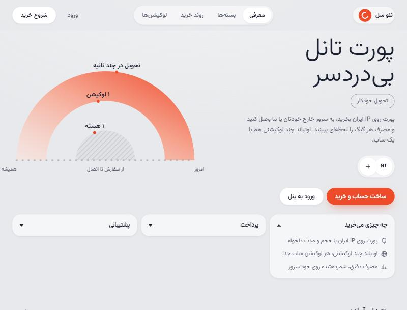
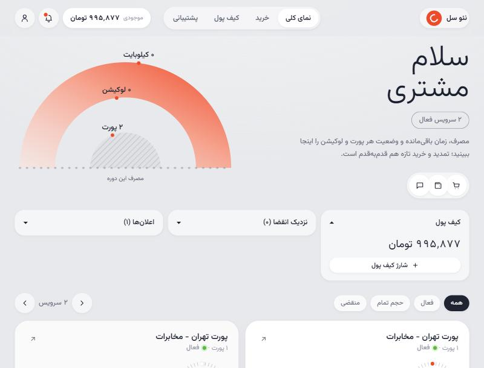
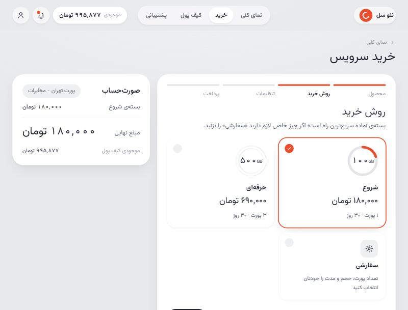
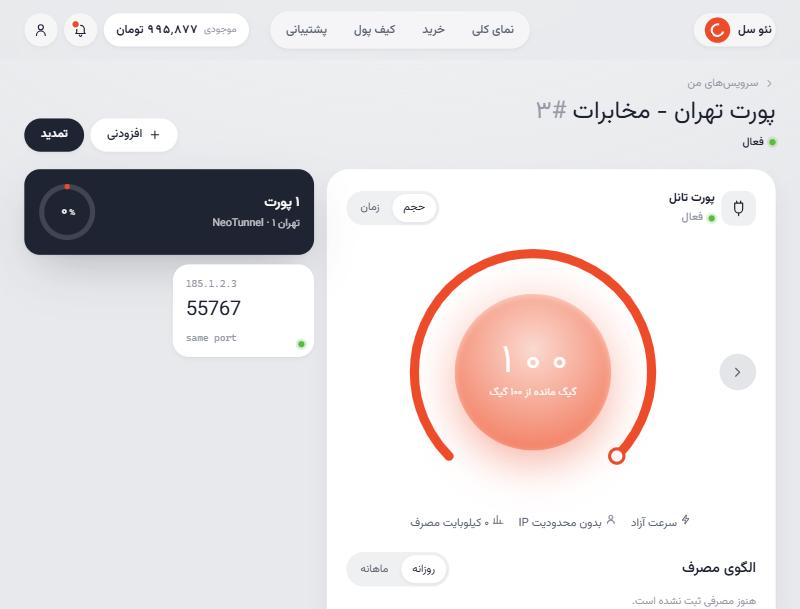
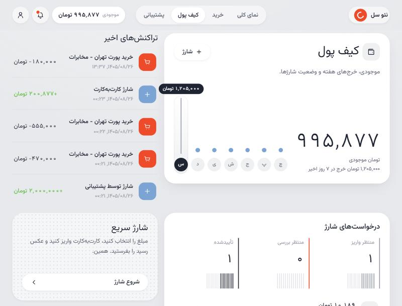
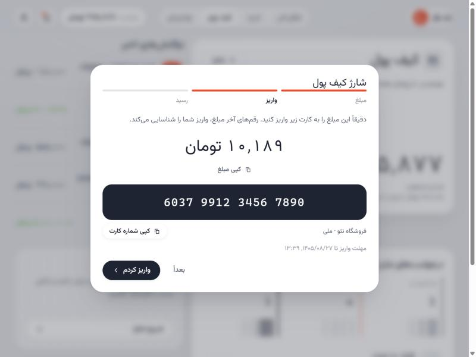
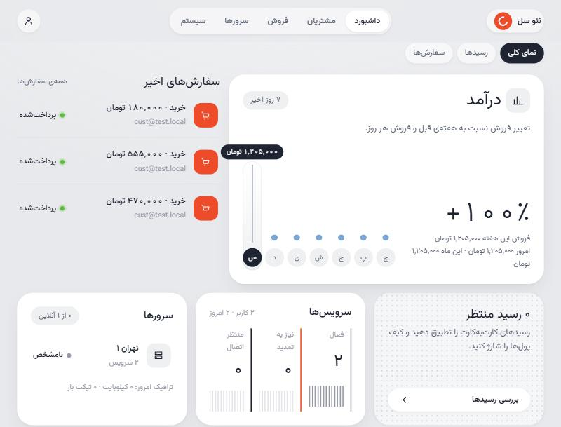
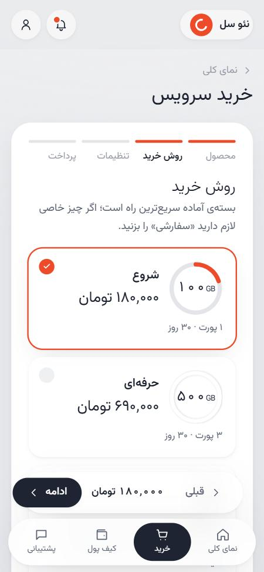

<div dir="rtl">

# Neo Sell

فروشگاه کامل **پورت تانل** (NeoTunnel، Kariz، Backpack) و **اوتباند** (پنل ثنایی / 3x-ui) — با کیف پول، خرید مرحله‌به‌مرحله، ربات تلگرام و مصرف دقیق. همه در **یک فایل**، بدون نصب هیچ برنامه‌ی دیگری.

<p align="center"> </p>

## نصب با یک دستور

روی یک سرور لینوکس تازه (اوبونتو ۲۰.۰۴ به بالا یا دبیان ۱۱ به بالا) با کاربر **root** این دستور را بزنید:

</div>

```bash
bash <(curl -fsSL https://raw.githubusercontent.com/neoauroraproject/neosell/main/scripts/install.sh)
```

<div dir="rtl">

نصب‌کننده سه سؤال ساده می‌پرسد:

| سؤال | چه جوابی بدهم |
|---|---|
| **Domain for the panel** | دامنه‌ی پنل، مثلاً `shop.example.com`. خالی بگذارید تا با IP سرور بالا بیاید. |
| **Email for SSL** | ایمیل برای اطلاع از تمدید گواهی (اختیاری؛ Enter بزنید). |
| **Panel port** | یک پورت آزاد **تصادفی** پیشنهاد می‌شود؛ Enter بزنید تا همان بماند. بعداً هر وقت خواستید عوضش کنید. |

در پایان آدرس پنل نمایش داده می‌شود:

</div>

```text
  ✓ shop.example.com points to this server (203.0.113.10)
  ✓ Neo Sell is running

  Open:  https://shop.example.com:34127
  The SSL certificate is issued on the first visit (takes a few seconds).
  Then create the owner account and enter your license key.
  Manage later with:  neosell
```

<div dir="rtl">

آدرس را باز کنید ← **حساب مالک** را بسازید ← **کلید لایسنس** را وارد کنید. فروشگاه آماده است. ✅

> **دامنه و SSL:** اگر دامنه دادید، گواهی رایگان Let's Encrypt **خودکار** گرفته و تمدید می‌شود. قبلش در DNS یک رکورد **A** برای دامنه به IP سرور بسازید، اگر از کلودفلر استفاده می‌کنید **ابر نارنجی را خاموش** کنید، و پورت **۸۰** سرور باز باشد.
>
> بدون دامنه، پنل با گواهی خودامضا روی IP بالا می‌آید؛ مرورگر یک بار هشدار می‌دهد، «ادامه» را بزنید.

## منوی مدیریت

هر وقت روی سرور فقط بنویسید `neosell` (یا همان دستور نصب را دوباره بزنید)، این منو باز می‌شود:

</div>

```text
  ● Neo Sell  v0.2.0
  panel: running  https://shop.example.com:34127

   1  Reinstall / reconfigure panel
   2  Update to the latest version
   3  Set domain & SSL (Let's Encrypt)
   4  Change panel port
   5  Show panel address
   6  Reset an admin password
   7  Restart panel
   8  Live logs (Ctrl+C to return)
   9  Backup database
  10  License status
  11  Uninstall
   0  Exit
```

<div dir="rtl">

| گزینه | کار |
|---|---|
| **۲ به‌روزرسانی** | آخرین نسخه را دانلود، با چک‌سام بررسی و جایگزین می‌کند و پنل را دوباره راه می‌اندازد. |
| **۳ دامنه و SSL** | دامنه بدهید یا عوض کنید؛ گواهی خودکار گرفته می‌شود. می‌توانید پنل را روی پورت ۴۴۳ ببرید تا آدرس بدون پورت باشد. |
| **۴ تغییر پورت** | پورت دلخواه را وارد کنید (یا `r` برای تصادفی). |
| **۶ رمز ادمین** | اگر رمز را فراموش کردید. |
| **۹ پشتیبان** | یک نسخه‌ی کامل از دیتابیس می‌سازد (پنل لازم نیست خاموش شود). |
| **۱۱ حذف** | سرویس‌ها را برمی‌دارد؛ می‌پرسد اطلاعات هم پاک شود یا بماند. |

### به‌روزرسانی از داخل پنل

پنل مدیریت ← **سیستم** ← **به‌روزرسانی**: نسخه‌ی فعلی و آخرین نسخه را می‌بینید و با یک کلیک به‌روز می‌کنید. فایل تازه با چک‌سام بررسی می‌شود و پنل چند ثانیه بعد با نسخه‌ی جدید برمی‌گردد. **سرویس‌های مشتری‌ها قطع نمی‌شوند.**

## راه‌اندازی فروشگاه (به ترتیب)

1. **سیستم ← تنظیمات:** نام فروشگاه، راه پشتیبانی، ثبت‌نام باز یا بسته، مهلت‌ها.
2. **سرورها ← سرور تانل ← افزودن:** سرور ایران را اضافه کنید و دکمه‌ی **«دستور نصب Agent»** را بزنید؛ دستوری که می‌دهد را روی همان سرور اجرا کنید. برای NeoTunnel آدرس محلی پنل NeoTunnel و یک توکن API (دسترسی full) را وارد کنید.
3. **سرورها ← تانل اشتراکی:** اگر پورت‌ها روی سرور خارج خودتان فروخته می‌شوند (برای NeoTunnel نام تانل، مثلاً `t1`).
4. **سرورها ← پنل ثنایی ← اوتباندها:** پنل‌های 3x-ui را اضافه کنید و اینباندهای هر لوکیشن را ثبت کنید.
5. **فروش ← کلاس پورت ← محصولات ← قوانین قیمت:** پورت‌های قابل فروش، محصول‌ها و قیمت‌ها. نتیجه را در **ماشین‌حساب** امتحان کنید.
6. **فروش ← کارت‌ها:** شماره کارت برای شارژ کارت‌به‌کارت.
7. **سیستم ← تنظیمات ← ربات تلگرام:** توکن BotFather را بگذارید و روشن کنید.

## مشتری چه می‌بیند

خرید در **چهار قدم** است (محصول، روش خرید، تنظیمات، پرداخت) و قیمت کنار صفحه لحظه‌به‌لحظه حساب می‌شود. اگر موجودی کم باشد، شارژ همان مبلغ در همان صفحه انجام می‌شود.

<p align="center"> </p>
<p align="center"> </p>
<p align="center"> </p>

## سؤال‌های رایج

<details><summary><b>گواهی SSL گرفته نمی‌شود</b></summary>

- رکورد A دامنه باید دقیقاً به IP همین سرور اشاره کند (نصب‌کننده بررسی می‌کند و هشدار می‌دهد).
- پروکسی CDN (ابر نارنجی) را برای این رکورد خاموش کنید.
- پورت ۸۰ باید باز و آزاد باشد (وب‌سرور دیگری روی آن نباشد).
- لاگ: `neosell` ← گزینه‌ی ۸.
</details>

<details><summary><b>سرور ایران به اینترنت آزاد دسترسی ندارد</b></summary>

برای لایسنس و تلگرام یک پراکسی خروجی بدهید:

</div>

```bash
neosell install -proxy socks5://127.0.0.1:1080
```

<div dir="rtl">
</details>

<details><summary><b>نصب بدون سؤال (برای اسکریپت)</b></summary>

</div>

```bash
bash <(curl -fsSL https://raw.githubusercontent.com/neoauroraproject/neosell/main/scripts/install.sh) \
  install -yes -domain shop.example.com -email you@example.com
```

<div dir="rtl">
</details>

<details><summary><b>انتقال به سرور دیگر</b></summary>

در منو گزینه‌ی ۹ (پشتیبان) را بزنید و فایل پشتیبان به‌همراه `/var/lib/neosell/secret.key` را به سرور جدید ببرید. آنجا نصب کنید، سرویس را متوقف کنید (`systemctl stop neosell`)، فایل را جای `/var/lib/neosell/neosell.db` بگذارید و دوباره روشن کنید. لایسنس روی سرور جدید با «آزادسازی دستگاه» در پورتال لایسنس منتقل می‌شود.
</details>

## دستورها

</div>

```text
neosell                                   منوی مدیریت
neosell install [-domain d] [-email e] [-port N] [-tls acme|self|off|file] [-yes]
neosell update [-check]                   به‌روزرسانی به آخرین نسخه (با بررسی چک‌سام)
neosell agent join -panel URL -token T    نصب Agent روی سرور تانل (دستورش را پنل می‌دهد)
neosell backup -out FILE                  پشتیبان از دیتابیس
neosell admin reset-password EMAIL PASS
neosell license status|recheck
neosell version
```

<div dir="rtl">

## برای توسعه‌دهنده

- طراحی کامل: [docs/PLAN.md](docs/PLAN.md)
- ساخت: `./scripts/build.sh` (vet + تست + باینری‌های `linux/amd64` و `linux/arm64` + `SHA256SUMS`). فقط Go 1.24+ لازم است؛ رابط وب بدون build داخل باینری است.
- انتشار نسخه: `./scripts/release.sh v0.2.0 "تغییرات…"` — همان نسخه‌ای که نصب‌کننده، `neosell update` و صفحه‌ی به‌روزرسانی پنل از آن استفاده می‌کنند.
- سرور لایسنس: مسیر `POST /v1/neosell/license` در `hm-license-manager`؛ کلید امضا با `wrangler secret put NEOSELL_LICENSE_PRIVATE_KEY`.

</div>

<div dir="rtl">

## شرایط استفاده

استفاده از Neo Sell **آزاد** است: می‌توانید آن را نصب کنید و برای فروش سرویس‌های خودتان به کار ببرید.
**کپی‌برداری ممنوع است:** کپی، تغییر، بازنشر یا فروش کد یا بخشی از آن، و ساختن نسخه‌ی دیگری از روی آن، بدون اجازه‌ی کتبی تیم NeoAurora مجاز نیست. همه‌ی حقوق محفوظ است.

</div>

**Terms of use:** Neo Sell is free to use — install it and run it for your own business. Copying, modifying, redistributing, reselling or creating derivative works from this code, in whole or in part, is prohibited without written permission from the NeoAurora team. All rights reserved.

<div align="center">

---

### 🌌 NEO AURORA

<p>
  <a href="https://t.me/neoaurora">Telegram</a> &nbsp;·&nbsp;
  <a href="https://t.me/hmraysupport">Support</a> &nbsp;·&nbsp;
  <a href="https://t.me/neolicensebot">License Bot</a> &nbsp;·&nbsp;
  <a href="https://github.com/neoauroraproject">GitHub</a>
</p>

<p>
  <a href="https://t.me/hmpanel">HMPanel Community</a>
  &nbsp;·&nbsp;
  <a href="https://t.me/neotunnels">NeoTunnel Community</a>
  &nbsp;·&nbsp;
  <a href="https://github.com/neoauroraproject?tab=repositories">All Projects</a>
</p>

<br>

### 💖 Support Our Development

<p>
  Your support helps us maintain and improve our projects.
</p>

<p>
  <a href="https://bscscan.com/address/0x94efb6642b8fcc591c28a8c04db2279908f66e18">
    
  </a>
  <br>
  <code>0x94efb6642b8fcc591c28a8c04db2279908f66e18</code>
</p>

<p>
  <a href="https://tonscan.org/address/UQD6NpICg2Q7nF_yFRrKW2_ZgB5LPI1X2KDK0JDjlivwhCJ5">
    
  </a>
  <br>
  <code>UQD6NpICg2Q7nF_yFRrKW2_ZgB5LPI1X2KDK0JDjlivwhCJ5</code>
</p>

<p>
  <a href="https://tronscan.org/#/address/TJsBskCPtbVk6gKxTkcocjJX2qNa62Mo1X">
    
  </a>
  <br>
  <code>TJsBskCPtbVk6gKxTkcocjJX2qNa62Mo1X</code>
</p>

<br>

⭐ **Enjoying this project? Give it a star!**

<p>
  Every star helps us grow and reach more developers.
</p>

**Crafted with ❤️ by the NeoAurora Team**

<sub>Free to Use · All Rights Reserved · Built with Passion</sub>

---
</div>
